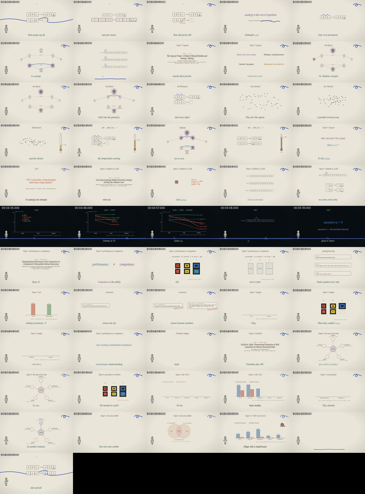
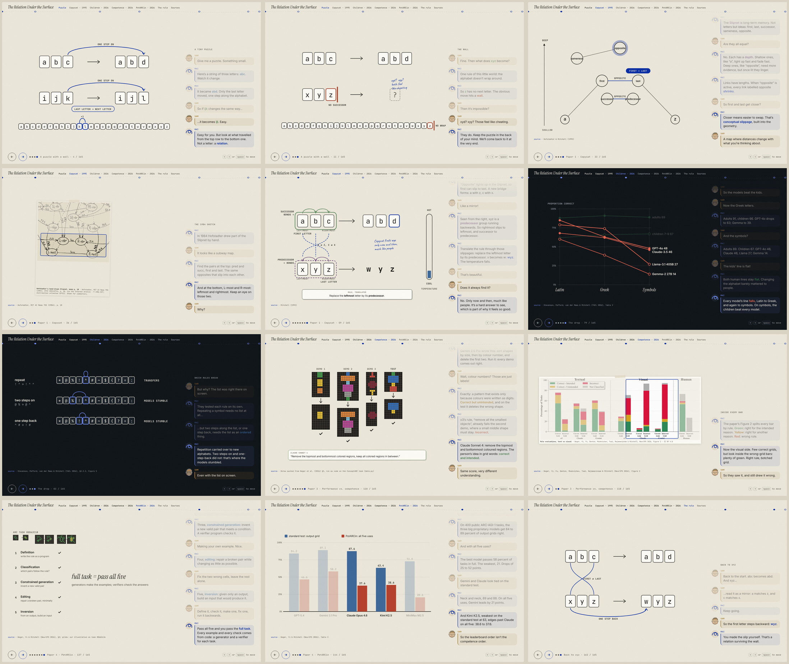

# MAI (脉) video style system

A house style, an asset library and a deterministic render kit, built by analysing four reference reels and merging their best traits. Agents (or people) use it to make short explainer and essay videos that are **consistent from one video to the next and identical from one render to the next**.

> **One thread. Warm paper. Precise ink. Every scene becomes the next.**


## Map

| Path | What it is |
|---|---|
| [`DOMAIN.md`](DOMAIN.md) | **Start here.** The domain model: bounded contexts, entities, invariants, lifecycle, vocabulary. |
| [`RULES.md`](RULES.md) | The style rules (with IDs). Rules tagged `[lint]` are machine-checked. |
| [`../.claude/skills/mai-video/SKILL.md`](../.claude/skills/mai-video/SKILL.md) | The agent workflow. Claude Code discovers it automatically in this repo. |
| [`analysis/REFERENCE_ANALYSIS.md`](analysis/REFERENCE_ANALYSIS.md) | What each reference reel does, what was taken from each and why, and the emergent properties of the merge. |
| `analysis/fingerprints/*.json` | Measured data per reel: palette, accents, motion energy, cuts, tempo, VO pace. |
| `tokens/*.tokens.json` | Design tokens (DTCG format): colour roles × 2 modes, typography, motion, layout, texture, audio. |
| `schemas/` | JSON Schemas for asset manifests and storyboards. |
| [`assets/ASSETS.md`](assets/ASSETS.md) | How assets are structured, created, versioned and frozen. |
| `assets/**/asset.json` | The library: motif, character, icons, textures, fonts, sounds, voices, frozen dialogue VO, diagram templates (38 assets). |
| `assets.lock.json` | sha256 of every asset file: the determinism contract. |
| `storyboards/*.yaml` | Videos, described as data. `give-it-a-thread.yaml` is the single-narrator example; `the-thread-dialogue.yaml` is the **guide + learner dialogue** example; `analogy-to-arc.yaml` is a **10-minute, 16:9 paper explainer** generated by `builders/analogy_to_arc.py`, with its fact ledger in `builders/FACTS.md`. `.timed.yaml` files are generated. |
| `kit/` | Remotion 4 render kit: components that read *only* tokens, assets and storyboards. |
| [`explainers/EXPLAINER.md`](explainers/EXPLAINER.md) | **Hand-navigated HTML explainers** (no narration): the page domain model, rules X1–X13, the engine, views and `build.py`. `explainers/out/analogy-to-arc.html` is the worked example. |
| `golden/` | Perceptual signatures of key frames, used for regression and determinism checks. |
| `tools/` | `lint_storyboard.py`, `asset_lock.py`, `dialogue.py` (voices and times two-speaker scripts), `master.py` (loudness), `gen_audio.py`, `analyze_reference.py`, `contact_sheet.sh`, `explainer_walk.js` (steps through an explainer page in Chromium). |
| `docs/` | Rendered asset sheet; demo and dialogue videos with contact sheets; the 10-minute explainer's contact sheet and a 72 s excerpt of its TURN. |

## Pipeline

```
brief → motif.meaning + concepts → dialogue script (guide + learner; HOOK DEFINE LADDER TURN RULE RETURN)
      → tools/dialogue.py (voice each line once, freeze, time captions to the audio)
      → storyboards/<id>.timed.yaml ──lint_storyboard.py──▶ errors? fix
      → assets resolved (asset_lock.py --check) ──missing? create once, freeze, lock
      → --emit kit/src/storyboards/<id>.json → Remotion render → contact sheet + golden check → review
```

## Quick start

```bash
pip install pyyaml jsonschema numpy soundfile pyloudnorm piper-tts # tools (piper only for dialogue)
python3 -I video-style/tools/lint_storyboard.py video-style/storyboards/give-it-a-thread.yaml \
        --emit video-style/kit/src/storyboards/give-it-a-thread.json
cd video-style/kit && npm ci
npx remotion studio                                                 # preview
npx remotion render MaiDemo out/mai-demo.mp4                        # render (single narrator, no VO)
npx remotion render MaiDialogue out/mai-dialogue.mp4                # render the two-voice dialogue demo
python3 -I ../tools/master.py out/mai-dialogue.mp4                  # master to -14 LUFS
node scripts/golden.mjs                                             # regression/determinism check
```
In sandboxes without Remotion's own Chrome, set `--browser-executable=…/chrome-headless-shell` (CLI) or `REMOTION_BROWSER=…` (golden script).

### The 10-minute explainer (*The Relation Under the Surface*)



The master (1920×1080, 10:13, 123 MB) is not committed, because it exceeds GitHub's file limit. Every input is frozen (storyboard, VO lines, assets and lockfile), so it re-renders frame-identically. [`docs/analogy-to-arc-turn.mp4`](docs/analogy-to-arc-turn.mp4) is a 72 s, 720p excerpt.
```bash
python3 -I video-style/storyboards/builders/analogy_to_arc.py            # → analogy-to-arc.yaml
python3 -I video-style/tools/dialogue.py video-style/storyboards/analogy-to-arc.yaml   # reuses the frozen lines
python3 -I video-style/tools/lint_storyboard.py video-style/storyboards/analogy-to-arc.timed.yaml \
        --emit video-style/kit/src/storyboards/analogy-to-arc.json
cd video-style/kit && STORYBOARD=analogy-to-arc.json scripts/render_long.sh AnalogyToArc out/analogy
python3 -I ../tools/master.py out/analogy/AnalogyToArc.mp4               # → -14 LUFS / -1 dBTP
```
Credit for the video description: *Learner voice: "alba" (Edinburgh DataShare 10283/3270), CC BY 4.0. Guide voice: "joe", CC0.*

### The same story as a page you step through (no voice)



[`explainers/out/analogy-to-arc.html`](explainers/out/analogy-to-arc.html) is one self-contained file (1.7 MB): 58 scenes and 165 steps, navigated with ← / → / space or a swipe. Two characters talk in the side panel (Mai, the guide, drawn as the thread; Sam, the learner, the house character). The stage does the explaining: letter tiles that change, Copycat's Workspace building and breaking structures on xyz, the Slipnet's links shrinking, the real ConceptARC tasks with the paper's quoted model rules **run as code**, PotARCin's five uses on an ARC task, and the papers' own figures (CC BY 4.0), the 1984 Copycat memo (Internet Archive) and Wikimedia portraits as credited clippings.
```bash
python3 -I video-style/explainers/analogy-to-arc/data.py      # grids + rule runs, with assertions
python3 -I video-style/explainers/build.py analogy-to-arc     # lint (X1–X7) + one HTML file, byte-stable
node video-style/tools/explainer_walk.js video-style/explainers/out/analogy-to-arc.html /tmp/walk   # QA
```

## Adding a new favourite video to the style

1. `python3 -I video-style/tools/analyze_reference.py <url> <name> --out /tmp/refs`
2. Look at the contact sheets. Copy `<name>.json` into `analysis/fingerprints/`.
3. Add a section to `REFERENCE_ANALYSIS.md` using the *Steal / Leave / Why* table.
4. If it changes a rule or token, edit `RULES.md` or `tokens/`, then re-run `node kit/scripts/golden.mjs --update` and review the diff in the asset sheet.

## Tooling landscape (researched Oct 2026)

| Tool | Role here |
|---|---|
| [Remotion](https://www.remotion.dev) 4.0.539 | The renderer used by `kit/` (React, frame-pure, seeded `random()`). It ships official agent skills: `npx skills add remotion-dev/skills`. Commercial use by companies of 4+ people needs a Remotion licence. |
| [HyperFrames](https://github.com/heygen-com/hyperframes) (HeyGen, Apache-2.0) | HTML + GSAP → MP4 with a seekable virtual clock, built for agents. It is a drop-in alternative renderer: tokens, assets and storyboards stay the same, only `kit/` would change. |
| Motion Canvas / Revideo | Code-first alternatives (generator-based timelines). |
| Manim CE | Best for heavy math scenes. Render one as a frozen `footage.*` asset and treat it. |
| yt-dlp · ffmpeg · librosa · faster-whisper | Reference analysis (`tools/analyze_reference.py`). |
| W3C DTCG token format | The format of `tokens/*.tokens.json`. Style Dictionary can compile it to CSS or other targets. |
