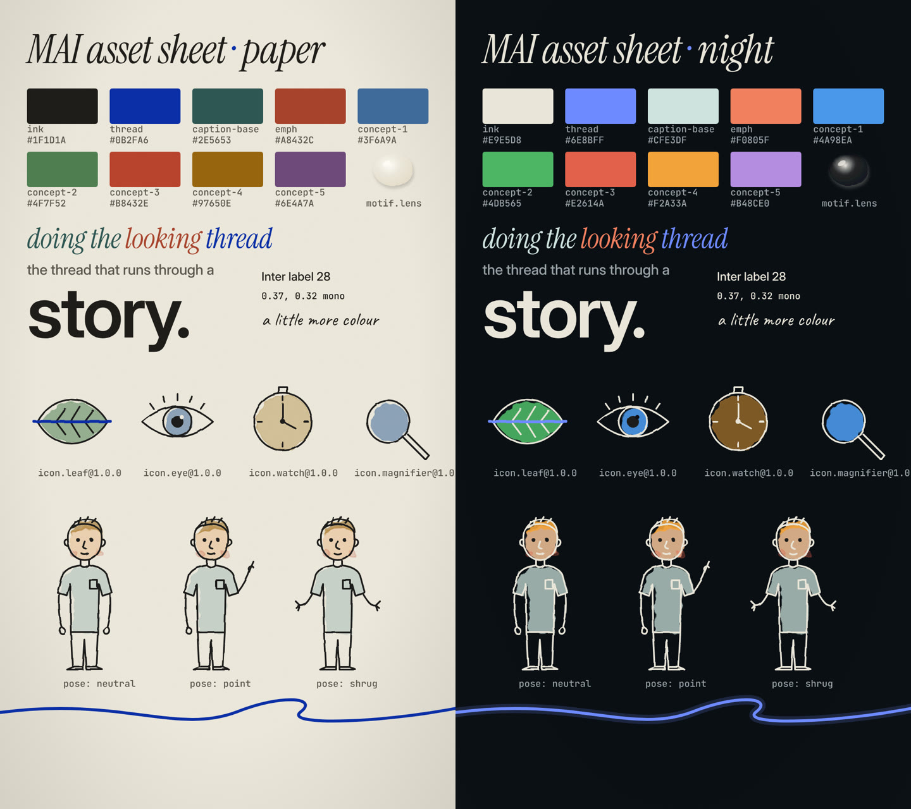

# MAI (脉) video style system

A house style, an asset library and a deterministic render kit, built by analysing four reference reels and merging their best traits. Agents (or people) use it to make short explainer and essay videos that are **consistent from one video to the next and identical from one render to the next**.

> **One thread. Warm paper. Precise ink. Every scene becomes the next.**



## Map

| Path | What it is |
|---|---|
| [`DOMAIN.md`](DOMAIN.md) | **Start here.** The domain model: bounded contexts, entities, invariants, lifecycle, vocabulary. |
| [`RULES.md`](RULES.md) | The style rules (with IDs). Rules tagged `[lint]` are machine-checked. |
| [`../.claude/skills/mai-video/SKILL.md`](../.claude/skills/mai-video/SKILL.md) | The agent workflow. Claude Code discovers it automatically in this repo. |
| [`analysis/REFERENCE_ANALYSIS.md`](analysis/REFERENCE_ANALYSIS.md) | What each reference reel does, what was taken from each and why, and the emergent properties of the merge. |
| `analysis/fingerprints/*.json` | Measured data per reel: palette, accents, motion energy, cuts, tempo, VO pace. |
| `tokens/*.tokens.json` | Design tokens (DTCG format): colour roles × 2 modes, typography, motion, layout, texture, audio. |
| `schemas/` | JSON Schemas for asset manifests and storyboards. |
| [`assets/ASSETS.md`](assets/ASSETS.md) | How assets are structured, created, versioned and frozen. |
| `assets/**/asset.json` | The library: motif, character, icons, textures, fonts, sounds (19 assets). |
| `assets.lock.json` | sha256 of every asset file: the determinism contract. |
| `storyboards/*.yaml` | Videos, described as data. `give-it-a-thread.yaml` is the worked example. |
| `kit/` | Remotion 4 render kit: components that read *only* tokens, assets and storyboards. |
| `golden/` | Perceptual signatures of key frames, used for regression and determinism checks. |
| `tools/` | `lint_storyboard.py`, `asset_lock.py`, `gen_audio.py`, `analyze_reference.py`, `contact_sheet.sh`. |
| `docs/` | Rendered asset sheet, demo video and demo contact sheet. |

## Pipeline

```
brief → motif.meaning + concepts → script (HOOK DEFINE LADDER TURN RULE RETURN)
      → storyboards/<id>.yaml ──lint_storyboard.py──▶ errors? fix
      → assets resolved (asset_lock.py --check) ──missing? create once, freeze, lock
      → --emit kit/src/storyboards/<id>.json → Remotion render → contact sheet + golden check → review
```

## Quick start

```bash
pip install pyyaml jsonschema numpy soundfile pyloudnorm           # tools
python3 -I video-style/tools/lint_storyboard.py video-style/storyboards/give-it-a-thread.yaml \
        --emit video-style/kit/src/storyboards/give-it-a-thread.json
cd video-style/kit && npm ci
npx remotion studio                                                 # preview
npx remotion render MaiDemo out/mai-demo.mp4                        # render
node scripts/golden.mjs                                             # regression/determinism check
```
In sandboxes without Remotion's own Chrome, set `--browser-executable=…/chrome-headless-shell` (CLI) or `REMOTION_BROWSER=…` (golden script).

## Adding a new favourite video to the style

1. `python3 -I video-style/tools/analyze_reference.py <url> <name> --out /tmp/refs`
2. Look at the contact sheets. Copy `<name>.json` into `analysis/fingerprints/`.
3. Add a section to `REFERENCE_ANALYSIS.md` using the *Steal / Leave / Why* table.
4. If it changes a rule or token, edit `RULES.md` or `tokens/`, then re-run `node kit/scripts/golden.mjs --update` and review the diff in the asset sheet.

## Tooling landscape (researched Oct 2026)

| Tool | Role here |
|---|---|
| [Remotion](https://www.remotion.dev) 4.0.539 | The renderer used by `kit/` (React, frame-pure, seeded `random()`). It ships official agent skills: `npx skills add remotion-dev/skills`. Commercial use by companies of 4+ people needs a Remotion licence. |
| [HyperFrames](https://github.com/heygen-com/hyperframes) (HeyGen, Apache-2.0) | HTML + GSAP → MP4 with a seekable virtual clock, built for agents. It is a drop-in alternative renderer: tokens, assets and storyboards stay the same, only `kit/` would change. |
| Motion Canvas / Revideo | Code-first alternatives (generator-based timelines). |
| Manim CE | Best for heavy math scenes. Render one as a frozen `footage.*` asset and treat it. |
| yt-dlp · ffmpeg · librosa · faster-whisper | Reference analysis (`tools/analyze_reference.py`). |
| W3C DTCG token format | The format of `tokens/*.tokens.json`. Style Dictionary can compile it to CSS or other targets. |
